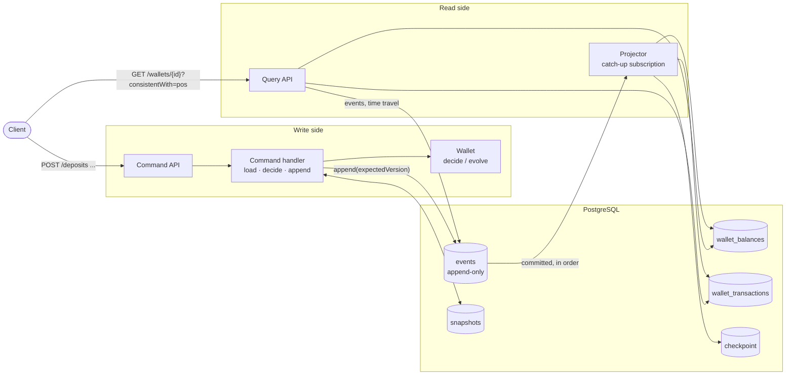

# Event Sourcing and CQRS: Wallet Ledger

[](https://github.com/alef2509/cqrs-event-sourcing-account-ledger/actions/workflows/ci.yml)


A digital wallet whose source of truth is an **append-only log of events**, built
from scratch on PostgreSQL. There is no framework (no Axon, no EventStoreDB), so
every mechanism is visible and tested: the event store, optimistic concurrency,
snapshots, upcasting, projections and replay.

The wallet supports deposits, withdrawals and **holds**: money reserved for a pending
payment, later captured or released, like a card pre-authorization.

## Architecture



## What is implemented

| Concern | How |
|---|---|
| **Aggregate** | Two pure functions, `decide(state, command) → events` and `evolve(state, event) → state`, over sealed interfaces and records. Tested as *given events / when command / then events*. |
| **Event store** | `events` table with global position and per-stream version; **triggers reject UPDATE, DELETE and TRUNCATE**. |
| **Concurrency** | Unique `(stream_id, stream_version)`. Conflicts are retried against fresh state with jittered backoff; `If-Match` pins a version (412). |
| **Snapshots** | Every 50 events; a versioned, disposable cache. Loading = latest snapshot + newer events. |
| **Schema evolution** | **Upcasting** on read: `FundsDeposited` v1 (integer cents, no currency) becomes v2 in memory; stored events are never rewritten. |
| **CQRS read models** | Balance per wallet and a customer statement, built by an exactly-once projector (checkpoint committed with the batch). |
| **Read-your-writes** | Commands return `X-Event-Position`; queries take `?consistentWith=` and wait for the projection. |
| **Never skip events** | Projector reads only committed transactions older than every in-flight one (`xid8` + `pg_snapshot_xmin`), see [ADR 3](docs/adr/0003-global-position-gaps.md). |
| **Replay** | `POST /api/v1/admin/projections/rebuild` wipes the read models and rebuilds them from the log. |
| **Time travel & audit** | `/history?version=n` gives the state at any version; `/events` returns the full history. |

## API

| Method | Path | Side |
|---|---|---|
| `POST` | `/api/v1/wallets` | write: open (`201`, `ETag`, `X-Event-Position`) |
| `POST` | `/api/v1/wallets/{id}/deposits` · `/withdrawals` | write (optional `If-Match`) |
| `POST` | `/api/v1/wallets/{id}/holds` | write: reserve money, returns `holdId` |
| `POST` | `/api/v1/wallets/{id}/holds/{holdId}/capture` · `/release` | write |
| `POST` | `/api/v1/wallets/{id}/freeze` | write: only releases allowed afterwards |
| `GET` | `/api/v1/wallets/{id}?consistentWith={position}` | read model |
| `GET` | `/api/v1/wallets/{id}/statement` | read model |
| `GET` | `/api/v1/wallets/{id}/events` | event store: audit trail |
| `GET` | `/api/v1/wallets/{id}/history?version={n}` | event store: time travel |
| `POST` | `/api/v1/admin/projections/rebuild` | replay |

Business rule violations are RFC 9457 problems with a type per rule
(`urn:problem-type:ledger:insufficient-funds`, `wallet-frozen`, `hold-not-found`...).

```bash
docker compose up --build    # or: ./mvnw spring-boot:test-run (Testcontainers)

W=$(curl -s -X POST localhost:8080/api/v1/wallets -H 'Content-Type: application/json' \
      -d '{"owner": "Ada", "currency": "EUR"}' | jq -r .walletId)
curl -s -X POST localhost:8080/api/v1/wallets/$W/deposits -H 'Content-Type: application/json' -d '{"amount": 100}'
P=$(curl -s -i -X POST localhost:8080/api/v1/wallets/$W/holds -H 'Content-Type: application/json' \
      -d '{"amount": 30, "reference": "order-1"}' | grep -i x-event-position | tr -dc 0-9)
curl -s "localhost:8080/api/v1/wallets/$W?consistentWith=$P" | jq    # available 70, held 30
curl -s "localhost:8080/api/v1/wallets/$W/events" | jq '.[].type'
```

## Testing

```bash
./mvnw verify
```

| Test | Proves |
|---|---|
| `WalletTest` (unit) | every business rule as given/when/then over events |
| `EventSerializerTest` (unit) | round trip, **v1 → v2 upcasting**, money stays exact (no `double` on the way) |
| `EventStoreIT` | ordering, optimistic concurrency, **immutability triggers**, **no skipped positions with an open transaction**, upcasting from the database |
| `LedgerApiIT` | holds/capture/release in both read models, rule violations, stale `If-Match`, **25 concurrent deposits without gaps or lost money**, snapshot load equals full replay, time travel, **rebuild restores a corrupted read model** |

## Architecture decisions

1. [Event Sourcing for the wallet ledger](docs/adr/0001-event-sourcing.md)
2. [CQRS with asynchronous projections and read-your-writes](docs/adr/0002-cqrs-projections.md)
3. [Never skip events: reading the log by committed transactions](docs/adr/0003-global-position-gaps.md)

## Tech stack

Java 21 (sealed interfaces, records, pattern matching) · Spring Boot 3.5 · Spring JDBC ·
PostgreSQL 17 (JSONB, `xid8`, triggers) · Flyway · JUnit 5 · AssertJ · Testcontainers ·
Docker · GitHub Actions

## License

[MIT](LICENSE)
